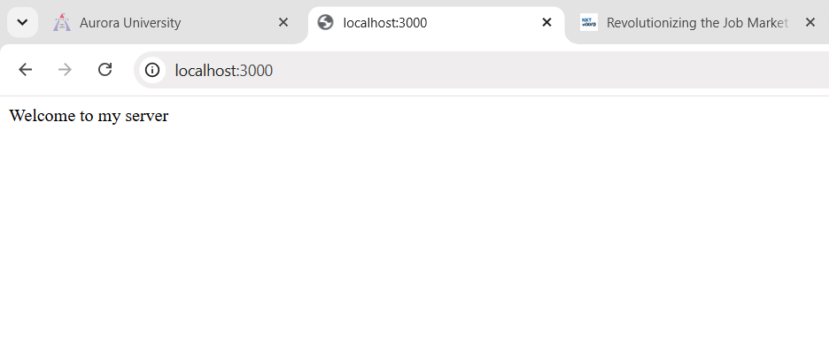
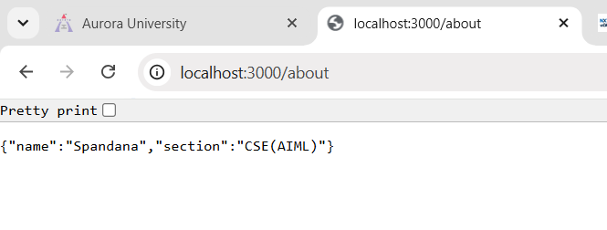
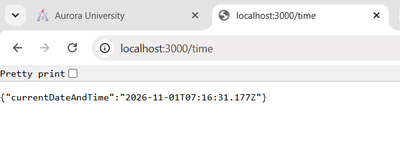
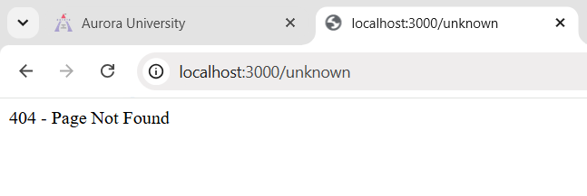

# Lab 1: Node.js and Express Server

## 1. Student Details

- **Name:** GONGUPALLY SPANDANA
- **Registration Number:** 252U1R6082
- **Section:** AIML-2B

## 2. Aim

To create a basic web server using Node.js and Express.js and understand how HTTP requests and responses work.

## 3. Technologies Used

- JavaScript
- Node.js
- Express.js
- Visual Studio Code
- Google Chrome

## 4. Description

This project demonstrates how to create a web server using Node.js and Express.js.

The server handles different GET requests and returns appropriate responses.

The project contains three main routes and one 404 error-handling route.

## 5. Installation and Execution

Follow these steps to run the project:

1. Install Node.js.
2. Open the project folder in Visual Studio Code.
3. Open the terminal.
4. Install Express using:

   `npm install express`

5. Start the server using:

   `node server.js`

6. Open the browser and visit:

   `http://localhost:3000`

## 6. API Routes

| HTTP Method | Endpoint | Description |
|---|---|---|
| GET | / | Displays welcome message |
| GET | /about | Displays student details in JSON format |
| GET | /time | Displays current date and time |
| GET | /unknown | Displays 404 Page Not Found |

## 7. Expected Outputs

### Home Route
Displays: Welcome to my server

### About Route
Returns student name and section in JSON format.

### Time Route
Returns the current date and time in JSON format.

### 404 Route
Displays: 404 - Page Not Found

## 8. Screenshots

### Home Page

### About Page

### Time Page

### 404 Error Page

## 9. Learning Outcomes

- Understood Node.js and its purpose.
- Learned how to initialize a Node.js project.
- Learned how to install Express.js.
- Created a basic HTTP server.
- Implemented GET routes using Express.js.
- Understood request and response objects.
- Learned JSON response handling.
- Implemented 404 error handling.

## 10. Conclusion

Successfully created and tested a web server using Node.js and Express.js. Implemented different GET routes and verified their responses using a web browser.